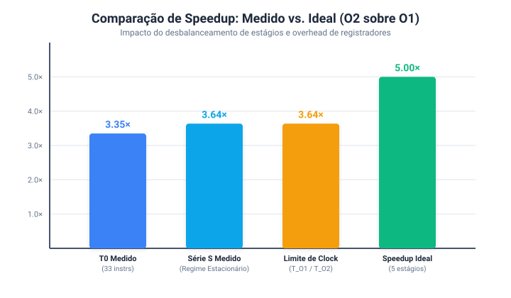
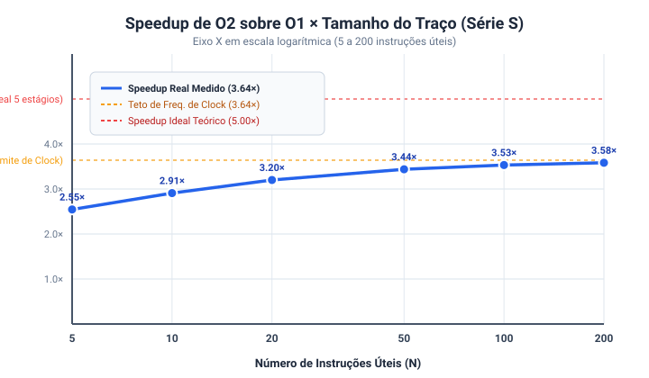
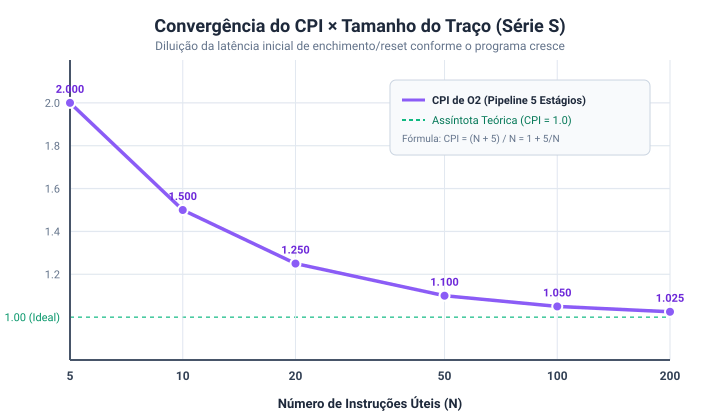

# Análise de Desempenho e Speedup: O2 (Pipeline) vs. O1 (Monociclo)

Este documento apresenta a análise de desempenho comparativa entre o processador **O1 (Monociclo)** e o processador **O2 (Pipeline de 5 estágios)**, atendendo ao requisito **R6** da especificação (`specs/MicroProj.pdf`) e aos critérios de aceite da **Issue #27**.

Todos os cálculos e gráficos apresentados baseiam-se **exclusivamente nos dados simulados registrados em `metricas.csv`** e nos períodos de clock fundamentados em [docs/periodo_clock.md](periodo_clock.md) ($T_{\text{clk, O1}} = 800\text{ ps}$ e $T_{\text{clk, O2}} = 220\text{ ps}$).

---

## 1. Tabela Comparativa de Métricas Consolidadas

A tabela abaixo consolida os dados de simulação do traço base **T0** e da **Série S** ($N \in \{5, 10, 20, 50, 100, 200\}$), calculando o tempo de execução real ($\text{Tempo} = \text{Ciclos} \times T_{\text{clk}}$) e o Speedup de O2 sobre O1:

| Programa | Instr. Úteis ($N$) | Ciclos O1 | Ciclos O2 | Tempo O1 ($T_{\text{clk}}=0{,}80\text{ns}$) | Tempo O2 ($T_{\text{clk}}=0{,}22\text{ns}$) | CPI O1 | CPI O2 | Ocupação O2 | Speedup Medido ($T_{\text{O1}} / T_{\text{O2}}$) |
| :--- | :---: | :---: | :---: | :---: | :---: | :---: | :---: | :---: | :---: |
| **S5** | 5 | 10 | 10 | $8{,}00\text{ ns}$ | $2{,}20\text{ ns}$ | 2,000 | 2,000 | 60,0% | **$3{,}64\times$** |
| **S10** | 10 | 15 | 15 | $12{,}00\text{ ns}$ | $3{,}30\text{ ns}$ | 1,500 | 1,500 | 73,3% | **$3{,}64\times$** |
| **S20** | 20 | 25 | 25 | $20{,}00\text{ ns}$ | $5{,}50\text{ ns}$ | 1,250 | 1,250 | 84,0% | **$3{,}64\times$** |
| **T0 (Base)**| **33** | **35** | **38** | **$28{,}00\text{ ns}$** | **$8{,}36\text{ ns}$** | **1,061** | **1,152** | **89,5%** | **$3{,}35\times$** |
| **S50** | 50 | 55 | 55 | $44{,}00\text{ ns}$ | $12{,}10\text{ ns}$ | 1,100 | 1,100 | 92,7% | **$3{,}64\times$** |
| **S100** | 100 | 105 | 105 | $84{,}00\text{ ns}$ | $23{,}10\text{ ns}$ | 1,050 | 1,050 | 96,2% | **$3{,}64\times$** |
| **S200** | 200 | 205 | 205 | $164{,}00\text{ ns}$ | $45{,}10\text{ ns}$ | 1,025 | 1,025 | 98,0% | **$3{,}64\times$** |

---

## 2. Análise do Speedup: Medido vs. Teórico Ideal

O ganho de desempenho obtido com o pipeline O2 é ilustrado nos gráficos a seguir:

### 2.1 Comparativo de Speedup (Medido vs. Teto de Clock vs. Ideal)
No traço T0 e na Série S, comparamos o ganho empírico contra os limites teóricos da arquitetura:

- **Speedup Ideal Teórico (5 estágios):** Em condições ideais onde os 5 estágios fossem perfeitamente balanceados ($200\text{ ps}$ cada) e os registradores de pipeline tivessem atraso zero ($t_{\text{reg}} = 0$), o período seria $200\text{ ps}$ e o speedup teórico seria:
  $$S_{\text{ideal}} = \frac{T_{\text{clk, O1}}}{T_{\text{clk, O2, ideal}}} = \frac{1000\text{ ps}}{200\text{ ps}} = \mathbf{5{,}00\times}$$
- **Teto Real de Frequência de Clock ($3{,}64\times$):**
  Devido ao desbalanceamento intrínseco dos estágios (ID e WB levam $100\text{ ps}$, enquanto IF, EX e MEM demandam $200\text{ ps}$) e ao overhead de $20\text{ ps}$ dos flip-flops entre estágios:
  $$S_{\text{clock}} = \frac{T_{\text{clk, O1}}}{T_{\text{clk, O2}}} = \frac{800\text{ ps}}{220\text{ ps}} \approx \mathbf{3{,}64\times}$$
- **Speedup Medido no Traço T0 ($3{,}35\times$):**
  No traço heterogêneo T0, o custo inicial de enchimento (4 ciclos) sobre um volume de 33 instruções reduz ligeiramente o speedup para:
  $$S_{\text{T0}} = \frac{28{,}00\text{ ns}}{8{,}36\text{ ns}} \approx \mathbf{3{,}35\times}$$
  representando **$92\%$ do teto de clock** e **$67\%$ do speedup ideal de 5 estágios**.

---

### 2.2 Curva de Speedup na Série S (Escala Logarítmica)

O gráfico abaixo ilustra a evolução do Speedup em função do número de instruções úteis ($N \in [5, 200]$) com eixo X em escala logarítmica:

Na série sintética S, como o número de ciclos totais em ambas as organizações cresce de forma idêntica ($Ciclos = N + 5$), a relação de ciclos é unitária ($\text{Ciclos}_{\text{O1}} / \text{Ciclos}_{\text{O2}} = 1{,}0$), fazendo com que o speedup atinja exatamente a razão de frequências de clock:
$$S = \frac{(N + 5) \times 800\text{ ps}}{(N + 5) \times 220\text{ ps}} = \frac{800}{220} \approx \mathbf{3{,}64\times}$$

---

## 3. Análise Crítica do CPI: Por que o CPI de O2 pode ser maior ou menor que 1.0?

A métrica CPI (*Ciclos Por Instrução*) mede a eficiência do processador. No pipeline O2 ideal em regime estacionário, espera-se que 1 instrução se aposente a cada ciclo ($CPI = 1{,}0$).

No entanto, as medições em `metricas.csv` revelam variações importantes que respondem diretamente às questões de avaliação:

### 3.1 Por que o CPI de O2 é MAIOR que 1.0?
O CPI medido de O2 é sempre $\ge 1{,}0$ devido a quatro fatores físicos e metodológicos da simulação:

1. **Latência de Enchimento do Pipeline (*Pipeline Fill Latency*):**
   No início da execução, o pipeline está vazio. São necessários **4 ciclos** de clock para que a primeira instrução buscada no estágio IF avance pelos estágios ID, EX e MEM até atingir o estágio final WB e ser contabilizada como concluída (`retired`).
2. **Latência de Esvaziamento (*Pipeline Drain Latency*):**
   Ao final do traço, a instrução `break` deve percorrer todo o pipeline até o estágio WB para sinalizar a conclusão (`done = '1'`).
3. **Ciclos de Reset do Testbench:**
   O testbench aplica 2 ciclos síncronos de reset ativo antes de liberar a execução, os quais são contabilizados no ciclo total até `done`.
4. **Efeito do Tamanho do Programa (Amortização do Overhead):**
   O número total de ciclos em programas sequenciais sem hazard segue rigorosamente o modelo:
   $$\text{Ciclos}(N) = N + \text{Overhead} = N + 5$$
   Portanto, a fórmula analítica do CPI é:
   $$\text{CPI}(N) = \frac{\text{Ciclos}}{N} = \frac{N + 5}{N} = 1 + \frac{5}{N}$$
   - Para traços muito curtos ($N = 5$): o overhead fixo de 5 ciclos tem o mesmo peso das instruções úteis, resultando em $\text{CPI} = 1 + \frac{5}{5} = \mathbf{2{,}000}$.
   - Para traços médios ($N = 20$): $\text{CPI} = 1 + \frac{5}{20} = \mathbf{1{,}250}$.
   - Para traços longos ($N = 200$): o custo fixo de 5 ciclos é diluído sobre 200 instruções, convergindo para $\text{CPI} = 1 + \frac{5}{200} = \mathbf{1{,}025}$.
   - No limite assintótico: $\lim_{N \to \infty} \text{CPI}(N) = \mathbf{1{,}000}$.

---

### 3.2 O CPI de O2 pode ser MENOR que 1.0?
**Resposta: NÃO na organização O2 (Pipeline Escalar).**

- **Justificativa arquitetural:**
  O processador O2 é estritamente **escalar de via única** (*single-issue*). Ele possui apenas um conjunto de registradores entre estágios por nível e apenas uma porta de escrita no banco de registradores no estágio WB.
  Consequentemente, o estágio WB pode aposentar no máximo **1 instrução útil por ciclo de clock**:
  $$\text{IPC}_{\max} = 1{,}0 \implies \text{CPI}_{\min} = \frac{1}{\text{IPC}_{\max}} = \mathbf{1{,}000}$$
  Qualquer valor de CPI inferior a 1.0 violaria a lei física de conservação de fluxo do pipeline escalar.

- **Sob que condições o CPI seria menor que 1.0?**
  Um $\text{CPI} < 1{,}0$ (ou seja, $\text{IPC} > 1{,}0$) só seria possível em uma arquitetura **superescalar ou de emissão múltipla** (*multiple-issue*), como o processador **O3 de 2 vias** descrito conceitualmente na Seção 1.3 do enunciado. Com duas vias operando em paralelo, até 2 instruções podem concluir por ciclo no estágio WB, permitindo:
  $$\text{IPC}_{\max, \text{O3}} = 2{,}0 \implies \text{CPI}_{\min, \text{O3}} = \frac{1}{2{,}0} = \mathbf{0{,}500}$$

---

## 4. Análise da Taxa de Ocupação do Pipeline

A taxa de ocupação mede a fração de estágios ativos ao longo de toda a simulação:
$$\text{Ocupação} = \frac{\sum \text{estágios ocupados}}{\text{Ciclos} \times 5}$$

Conforme demonstrado em `metricas.csv`:
- Em **S5** ($N=5$), a ocupação média é de apenas **$60{,}0\%$**, porque os estágios passam grande parte do tempo ociosos durante o enchimento e esvaziamento.
- Em **T0** ($N=33$), a ocupação atinge **$89{,}5\%$**.
- Em **S200** ($N=200$), a ocupação atinge **$98{,}0\%$**, refletindo o regime permanente onde os 5 estágios (IF, ID, EX, MEM, WB) operam simultaneamente cheios em praticamente todos os ciclos.

---

## 5. Resumo Executivo para o Relatório SBC

1. **Aceleração Comprovada:** O pipeline O2 proporciona uma aceleração real de **$3{,}35\times$ a $3{,}64\times$** sobre o monociclo O1.
2. **Origem do Ganho:** O speedup decorre fundamentalmente da redução drástica no período de clock de $800\text{ ps}$ para $220\text{ ps}$ ($3{,}64\times$), viabilizada pela segmentação do caminho crítico.
3. **Convergência Assintótica:** O CPI de O2 inicia em $2{,}00$ para traços pequenos e converge suavemente para $1{,}025$ à medida que o tamanho do programa cresce, comprovando a diluição dos custos iniciais de inicialização do pipeline.
